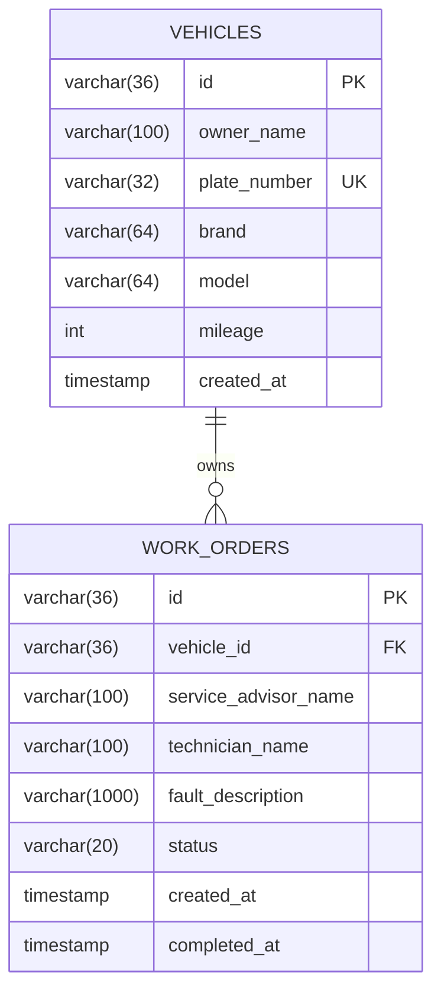

# 数据库设计

## 数据库概览

- 数据库：MySQL 8.4
- 数据库名：`maintenance`
- 字符集：`utf8mb4`
- ORM：Spring Data JPA / Hibernate

## 实体关系

关系说明：一辆车可以有多张维修工单，一张维修工单只能属于一辆车。

## vehicles 表

| 字段 | 类型 | 约束 | 说明 |
|---|---|---|---|
| `id` | `varchar(36)` | PK | UUID |
| `owner_name` | `varchar(100)` | NOT NULL | 车主姓名 |
| `plate_number` | `varchar(32)` | NOT NULL, UNIQUE | 车牌号 |
| `brand` | `varchar(64)` | NOT NULL | 品牌 |
| `model` | `varchar(64)` | NOT NULL | 车型 |
| `mileage` | `int` | NOT NULL | 当前里程，不小于 0 |
| `created_at` | `timestamp` | NOT NULL | 建档时间 |

约束名称：`uk_vehicles_plate_number`。

## work_orders 表

| 字段 | 类型 | 约束 | 说明 |
|---|---|---|---|
| `id` | `varchar(36)` | PK | UUID |
| `vehicle_id` | `varchar(36)` | NOT NULL, FK | 所属车辆 |
| `service_advisor_name` | `varchar(100)` | NOT NULL | 服务顾问 |
| `technician_name` | `varchar(100)` | NOT NULL | 维修技师 |
| `fault_description` | `varchar(1000)` | NOT NULL | 故障描述 |
| `status` | `varchar(20)` | NOT NULL | 工单状态 |
| `created_at` | `timestamp` | NOT NULL | 创建时间 |
| `completed_at` | `timestamp` | NULL | 完成时间 |

外键：`vehicle_id` 引用 `vehicles(id)`。

## 业务约束

- 车牌号在车辆表中唯一。
- 工单必须关联已存在车辆。
- 同一车辆不能同时有多张 `CREATED` 或 `IN_PROGRESS` 工单；该规则在 Service 中检查，因为约束依赖当前状态集合。
- 工单完成后写入 `completed_at`，状态更新为 `COMPLETED`。

## 测试数据

测试使用 H2 内存数据库，`ddl-auto: create-drop`。Repository、Service 和 API 测试会在每个测试中自行创建数据并通过事务或测试框架回滚，不依赖本机 MySQL 历史数据。

MySQL 手工验证可使用 `monolith/scripts/sample-data.sql`。
